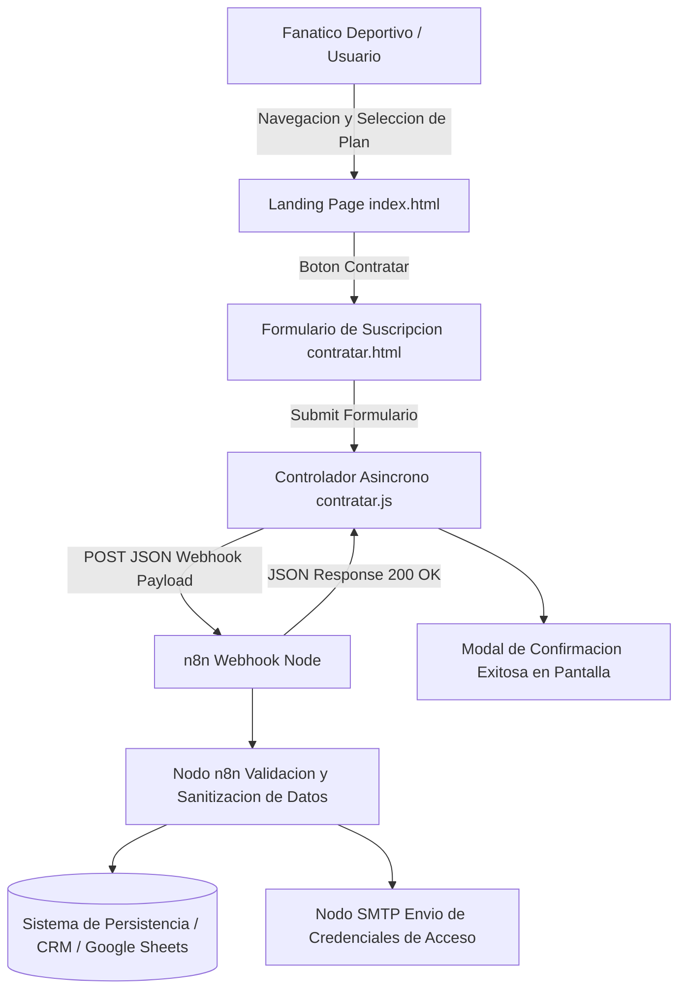

# MundoFutbol - Portal de Suscripcion y Contratacion de Streaming Deportivo Integrado con n8n

Plataforma web de captacion de clientes y pasarela de suscripciones para transmisiones deportivas, integrada de forma asincrona con flujos automatizados de n8n.

[]()
[]()
[]()
[]()
[]()

## Resumen Ejecutivo

En las plataformas de streaming de contenidos digitales y transmisiones deportivas en vivo, la conversion de prospectos depende criticamente de una experiencia de contratacion sin fricciones y una activacion instantanea del servicio. MundoFutbol resuelve esta necesidad mediante una arquitectura desacoplada que enlaza un portal publico de alta tasa de conversion con un motor de orquestacion en n8n, permitiendo procesar altas de clientes, validar planes seleccionados y disparar notificaciones de bienvenida sin intermediacion humana.

## Alcance y Objetivos de Negocio

- Exposicion visual clara de los planes de streaming disponibles (Plan Basico, Plan Premium, Plan Temporada Completa).
- Formulario reactivo de contratacion con validacion dinamica del lado del cliente (`contratar.html`).
- Integracion webhook en tiempo real con el motor de automatizacion n8n (`Workflow.json`).
- Registro automatizado de nuevos suscriptores en base de datos o sistema CRM.
- Despacho automatico de correos transaccionales con credenciales de acceso a las transmisiones.

## Arquitectura del Sistema

El proyecto implementa una arquitectura orientada a eventos (Event-Driven Architecture):
1. Capa de Presentacion Web (`index.html`, `contratar.html`, `style.css`):
   Landing page y embudo de contratacion responsivo optimizado para conversion.
2. Capa de Logica de Cliente (`main.js`, `contratar.js`):
   Captura de eventos, validacion de inputs, preparacion de cargas utiles JSON y envio asincrono via Fetch API.
3. Capa de Orquestacion y Automatizacion (`Workflow.json` en n8n):
   Receptor Webhook HTTP, normalizador de datos, persistencia de prospectos y emisor de notificaciones transaccionales.

### Diagrama de Flujo Arquitectonico



### Estructura de Directorios

```text
Web-Page-WF-to-n8n-I-/
├── index.html           # Landing page principal con catalogo de partidos y paquetes de suscripcion
├── contratar.html       # Interfaz dedicada de suscripcion, datos personales y pago
├── main.js              # Comportamiento general de la landing, navegacion y animaciones
├── contratar.js         # Logica de validacion del formulario y conexion con Webhook n8n
├── style.css            # Hoja de estilos moderna, paleta de colores deportivos y diseno responsivo
├── Workflow.json        # Definicion exportable del flujo de trabajo automatizado en n8n
└── README.md            # Documentacion tecnica de ingenieria del proyecto
```

## Stack Tecnologico

Desarrollado bajo una arquitectura ligera con enfoque en rendimiento de carga y fiabilidad de integracion.

### Backend y Orquestacion de Procesos

-  Plataforma de integracion y flujos de trabajo basada en eventos.
-  Comunicacion asincrona desacoplada mediante endpoints HTTP.
-  Estandares de intercambio de informacion basados en JSON.

### Frontend y Experiencia de Usuario

-  Manipulacion del DOM y consumo asincrono de APIs mediante `fetch` nativo.
-  Estructura semantica optimizada para motores de busqueda (SEO).
-  Variables CSS, modo oscuro integrado y diseno adaptativo mobile-first.

### Servicios y Recursos Multimedia

- **Google Fonts (Inter)**: Tipografia clara y legible optimizada para plataformas transaccionales.
- **SVG Graphics**: Iconografia vectorial ligera garantizando nitidez en cualquier resolucion de pantalla.

## Requisitos Previos del Sistema

- Instancia de n8n activa (local o en la nube):
  - Version minima recomendada: n8n 1.0+
- Navegador web compatible con Fetch API y promesas asincronas:
  - Chrome 60+
  - Firefox 55+
  - Safari 11+
  - Edge 79+
- Servidor HTTP estatico para servir la aplicacion web.

### Configuracion de Endpoints de Integracion (`contratar.js`)

En `contratar.js`, definir la URL del Webhook de produccion de n8n:

```javascript
// URL del webhook de recepcion de contrataciones en n8n
const N8N_WEBHOOK_URL = "http://localhost:5678/webhook/suscripcion-futbol";
```

## Guia de Instalacion y Despliegue Local

1. Clonar el repositorio localmente:
```bash
git clone https://github.com/SantiSarmiento11/Web-Page-WF-to-n8n-I-.git
cd Web-Page-WF-to-n8n-I-
```

2. Levantar la instancia de n8n local mediante Docker:
```bash
docker run -it --rm --name n8n-streaming -p 5678:5678 n8nio/n8n
```

### Importacion y Activacion del Flujo en n8n

1. Acceder al panel de control de n8n en `http://localhost:5678`.
2. Crear un nuevo flujo y hacer clic en **Import from File**.
3. Seleccionar el archivo `Workflow.json` del repositorio.
4. Configurar las credenciales del servicio de correo y persistencia.
5. Activar el flujo (toggle en estado **Active**).

### Ejecucion del Portal Web

Iniciar un servidor web ligero para desarrollo:
```bash
# Ejecutar desde la raiz del repositorio:
python -m http.server 8080
```

Abrir la pagina en el navegador: `http://localhost:8080/index.html`

## Funcionamiento del Sistema

El embudo de conversion y activacion se ejecuta en 5 pasos:
1. El usuario navega por `index.html` examinando las transmisiones de partidos de futbol disponibles y caracteristicas tecnicas (HD/4K, multicamara, sin publicidad).
2. Elige un paquete y es redirigido a `contratar.html` con el plan preseleccionado.
3. Diligencia sus datos de contacto y detalles de suscripcion.
4. `contratar.js` intercepta el evento de envio, valida los campos y despacha la peticion HTTP a n8n.
5. n8n procesa la contratacion y el usuario recibe confirmacion inmediata en pantalla y en su bandeja de entrada.

### Experiencia de Usuario y Navegacion

- Barra de navegacion superior fija con acceso rapido a Partidos, Planes y Contacto.
- Seccion de Precios con tarjetas comparativas y llamados a la accion (CTA) destacados.
- Formulario de contratacion estructurado con calculo automatico del total a pagar segun la periodicidad elegida (mensual o anual).

### Carga Util del Formulario (JSON Payload)

Estructura enviada al webhook de n8n:
```json
{
  "nombre": "Santiago Sarmiento",
  "correo": "cliente@ejemplo.com",
  "telefono": "+57 300 1234567",
  "planSeleccionado": "Plan Temporada Completa",
  "periodicidad": "Anual",
  "metodoPago": "Tarjeta de Credito",
  "fechaSolicitud": "2026-11-11T12:00:00Z"
}
```

### Contrato del Webhook HTTP

| Metodo | URL | Payload de Entrada | Respuesta Esperada |
| :--- | :--- | :--- | :--- |
| `POST` | `/webhook/suscripcion-futbol` | Objeto JSON de suscripcion | `{"status": "OK", "mensaje": "Suscripcion procesada con exito"}` |

### Manejo de Estados de Red y Validaciones

- Validacion de correo electronico mediante expresion regular estandar antes de permitir el envio.
- Deshabilitacion del boton de envio durante la peticion asincrona para prevenir envios duplicados.
- Notificacion amigable en caso de perdida de conexion con el servidor.

## Estrategia de Pruebas y Aseguramiento de Calidad

- Pruebas de carga util simulando envios de formulario mediante cURL.
- Validacion de responsividad en emuladores de dispositivos moviles (iPhone, Pixel, iPad).
- Auditoria de rendimiento y optimizacion SEO con Google Lighthouse.

### Prueba de Envio con cURL

```bash
curl -X POST http://localhost:5678/webhook/suscripcion-futbol \
  -H "Content-Type: application/json" \
  -d '{"nombre": "Prueba Usuario", "correo": "test@test.com", "planSeleccionado": "Basico"}'
```

## Telemetria y Tasa de Conversion

El script emite registros estructurados en la consola para depuracion (`console.log`) y esta preparado para integrar herramientas de analitica de eventos como Google Tag Manager o Plausible Analytics.

## Consideraciones de Seguridad en Frontend

- Proteccion contra envios automatizados no deseados.
- Comunicacion obligatoria sobre HTTPS en entornos de produccion para salvaguardar los datos de suscripcion de los usuarios.

## Despliegue en Produccion

- **Landing Page**: Desplegable en GitHub Pages, Vercel o Netlify con entrega global a traves de CDN.
- **Orquestador n8n**: Alojado en servidor privado virtual (VPS) con gestion de colas y ejecuciones persistentes.

## Rendimiento y Tiempos de Respuesta

- Hoja de estilos `style.css` minificada y optimizada.
- Graficos vectoriales SVG incrustados para reducir el numero total de peticiones HTTP en la carga inicial.

## Matriz de Resolucion de Incidencias

| Incidencia | Causa Frecuente | Solucion |
| :--- | :--- | :--- |
| El formulario no envia los datos | URL de webhook en `contratar.js` no coincide | Actualizar `N8N_WEBHOOK_URL` con la URL correcta del flujo activo de n8n. |
| Error CORS en la consola del navegador | Politicas de origen cruzado en n8n | Asegurarse de que el webhook de n8n acepte peticiones desde el origen de la pagina web. |
| Los estilos no se aplican correctamente | Ruta relativa a `style.css` rota | Verificar que `style.css` se encuentre en la misma raiz que los archivos HTML. |
