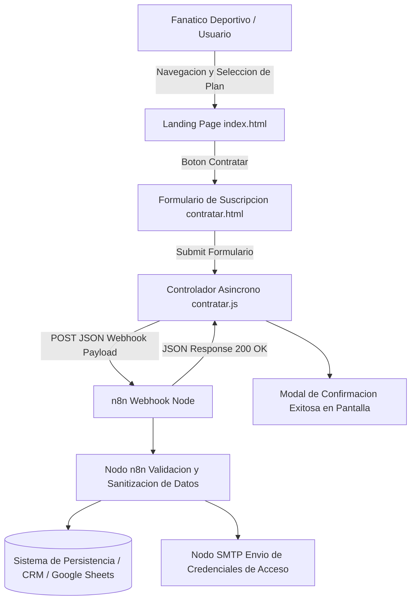

# MundoFutbol - Portal de Suscripcion y Contratacion de Streaming Deportivo Integrado con n8n

Plataforma web de captacion de clientes y pasarela de suscripciones para transmisiones deportivas, integrada de forma asincrona con flujos automatizados de n8n.

[]()
[]()
[]()
[]()
[]()

## Resumen Ejecutivo

En las plataformas de streaming de contenidos digitales y transmisiones deportivas en vivo, la conversion de prospectos depende criticamente de una experiencia de contratacion sin fricciones y una activacion instantanea del servicio. MundoFutbol resuelve esta necesidad mediante una arquitectura desacoplada que enlaza un portal publico de alta tasa de conversion con un motor de orquestacion en n8n, permitiendo procesar altas de clientes, validar planes seleccionados y disparar notificaciones de bienvenida sin intermediacion humana.

## Alcance y Objetivos de Negocio

- Exposicion visual clara de los planes de streaming disponibles (Plan Basico, Plan Premium, Plan Temporada Completa).
- Formulario reactivo de contratacion con validacion dinamica del lado del cliente (`contratar.html`).
- Integracion webhook en tiempo real con el motor de automatizacion n8n (`Workflow.json`).
- Registro automatizado de nuevos suscriptores en base de datos o sistema CRM.
- Despacho automatico de correos transaccionales con credenciales de acceso a las transmisiones.

## Arquitectura del Sistema

El proyecto implementa una arquitectura orientada a eventos (Event-Driven Architecture):
1. Capa de Presentacion Web (`index.html`, `contratar.html`, `style.css`):
   Landing page y embudo de contratacion responsivo optimizado para conversion.
2. Capa de Logica de Cliente (`main.js`, `contratar.js`):
   Captura de eventos, validacion de inputs, preparacion de cargas utiles JSON y envio asincrono via Fetch API.
3. Capa de Orquestacion y Automatizacion (`Workflow.json` en n8n):
   Receptor Webhook HTTP, normalizador de datos, persistencia de prospectos y emisor de notificaciones transaccionales.

### Diagrama de Flujo Arquitectonico



### Estructura de Directorios

```text
Web-Page-WF-to-n8n-I-/
├── index.html           # Landing page principal con catalogo de partidos y paquetes de suscripcion
├── contratar.html       # Interfaz dedicada de suscripcion, datos personales y pago
├── main.js              # Comportamiento general de la landing, navegacion y animaciones
├── contratar.js         # Logica de validacion del formulario y conexion con Webhook n8n
├── style.css            # Hoja de estilos moderna, paleta de colores deportivos y diseno responsivo
├── Workflow.json        # Definicion exportable del flujo de trabajo automatizado en n8n
└── README.md            # Documentacion tecnica de ingenieria del proyecto
```

## Stack Tecnologico

Desarrollado bajo una arquitectura ligera con enfoque en rendimiento de carga y fiabilidad de integracion.

### Backend y Orquestacion de Procesos

-  Plataforma de integracion y flujos de trabajo basada en eventos.
-  Comunicacion asincrona desacoplada mediante endpoints HTTP.
-  Estandares de intercambio de informacion basados en JSON.

### Frontend y Experiencia de Usuario

-  Manipulacion del DOM y consumo asincrono de APIs mediante `fetch` nativo.
-  Estructura semantica optimizada para motores de busqueda (SEO).
-  Variables CSS, modo oscuro integrado y diseno adaptativo mobile-first.
